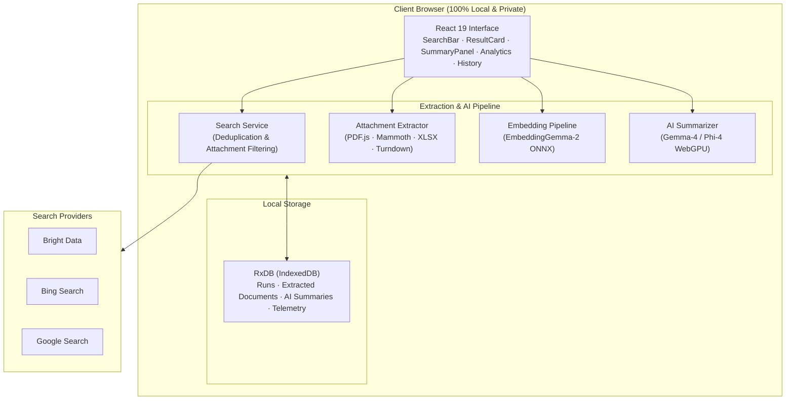

# 🧭 AttachSurfer

<div align="center">

[](https://react.dev/)
[](https://vitejs.dev/)
[](https://www.w3.org/TR/webgpu/)
[](https://rxdb.info/)
[](https://huggingface.co/docs/transformers.js)
[](https://webllm.mlc.ai/)
[](https://github.com)

**Privacy-first web search with automatic attachment extraction and AI-powered summarization.**  
*Everything runs 100% locally in your browser via WebGPU, WebAssembly, and RxDB. Zero server tracking.*

---

### 🎥 Watch the Demo Walkthrough

https://github.com/user-attachments/assets/demo.mp4

> **Interactive Video Walkthrough**: Check out the recorded demo walkthrough showcasing the search experience, attachment parsing, in-browser vector embeddings, and telemetry in [docs/demo.mp4](file:///Users/sameer_j/Documents/coding/attachsurfer/docs/demo.mp4).

</div>

---

## 🌟 Key Highlights

- 🔍 **Multi-Engine Aggregation**: Search seamlessly across **Bright Data SERP API**, **Bing Search v7**, and **Google Programmable Search**.
- 📎 **Deep Attachment Extraction**: Automatically isolates and extracts content from **PDF** (`.pdf`), **Word** (`.docx`), **Excel** (`.xlsx`), and **Web HTML**.
- 🧠 **100% In-Browser AI**: Local causal language models (**Gemma-4** & **Phi-4**) and vector embeddings (**EmbeddingGemma-2**) running directly on your GPU/CPU via WebGPU/Transformers.js.
- ⚡ **Search Within Results**: Semantic vector search and hybrid keyword ranking across extracted document contents.
- 📊 **Local Telemetry & Analytics**: Real-time performance dashboards tracking search API latency, document extraction time, and LLM inference duration.
- 💾 **Reactive Offline Database**: Built on **RxDB** with IndexedDB storage for offline history, run persistence, and saved outputs.
- 🎨 **Sleek Modern UI**: Pixel-perfect layout with fluid Dark/Light themes, collapsible summary panel, and hardware capability safety checks.

---

## 🚀 Quick Start

### 1. Clone & Install Dependencies

```bash
git clone https://github.com/learningsam20/attach-surfer.git
cd attachsurfer

# Install npm dependencies
npm install
```

### 2. Configure Environment

Copy `.env.example` to `.env` and add your search API credentials:

```bash
cp .env.example .env
```

At least one search API key is required to query live web engines:

| Engine | Environment Variable | Where to get it |
|--------|----------------------|-----------------|
| **Bright Data** | `VITE_BRIGHTDATA_API_KEY`<br/>`VITE_BRIGHTDATA_ZONE` | [brightdata.com](https://brightdata.com) → SERP API Zone |
| **Bing** | `VITE_BING_API_KEY` | [portal.azure.com](https://portal.azure.com) → Bing Search v7 resource |
| **Google** | `VITE_GOOGLE_API_KEY`<br/>`VITE_GOOGLE_CX` | [Google Cloud Console](https://console.cloud.google.com/) & [Programmable Search](https://programmablesearchengine.google.com/) |

### 3. Start Development Server

```bash
# Start Vite development server on port 5289
npm run dev
```

Visit **[http://localhost:5289](http://localhost:5289)** in Chrome, Edge, or any WebGPU-capable browser.

---

## 📦 In-Browser AI Models & Setup Script

AttachSurfer can serve and run models completely offline without contacting external model hubs during runtime. A dedicated setup and download script is included:

```bash
# Download all in-browser models (Gemma-4, EmbeddingGemma-2, and Phi-4) into public/models
npm run download-models
```

### Download Script Options

| Command | Purpose |
|---------|---------|
| `npm run download-models` | Downloads full configuration, tokenizers, and weights for all models |
| `npm run download-models -- --model=gemma4` | Download only Gemma-4 model assets |
| `npm run download-models -- --model=embeddinggemma2` | Download only EmbeddingGemma-2 ONNX vector weights |
| `npm run download-models -- --model=phi4` | Download only Phi-4 WebLLM MLC configuration and shards |
| `npm run download-models -- --mock` | **Fast development setup**: generates test manifests & mock weights instantly without multi-GB downloads |
| `npm run download-models -- --dir=public/custom_models` | Download to a custom destination directory |
| `npm run download-models -- --force` | Re-download and overwrite existing cached model files |

> **Note**: Model weights (`.onnx`, `.onnx_data`, `.litertlm`, `.bin`) are automatically excluded in `.gitignore` so your git repository stays lightweight.

---

## ⚙️ Configuration Reference

Edit `.env` or navigate to the in-app **Settings** tab to customize preferences:

```ini
# Search Engine API Keys
VITE_BRIGHTDATA_API_KEY=your_brightdata_key
VITE_BRIGHTDATA_ZONE=serp_api1
VITE_BING_API_KEY=your_bing_key
VITE_GOOGLE_API_KEY=your_google_key
VITE_GOOGLE_CX=your_google_cx

# Defaults & Behavior
VITE_DEFAULT_SEARCH_ENGINE=brightdata   # Options: brightdata, bing, google, all
VITE_DEFAULT_RESULT_COUNT=3             # Options: 1 to 10
VITE_DEFAULT_ATTACHMENT_FILTER=with     # Options: with (attachments only), without, all

# In-Browser AI Runtimes
VITE_AI_MODEL=phi4                      # Options: phi4, gemma4
VITE_EMBEDDING_MODEL=embeddinggemma2    # Options: embeddinggemma2 (768-dim), hash (128-dim)
VITE_AI_BACKEND=auto                    # Options: auto, litert-lm, transformers, webllm
VITE_LOCAL_MODELS_PATH=/models          # Static path served by Vite/web server

# Persistence & Telemetry
VITE_STORE_HISTORY=true
VITE_TELEMETRY_ENABLED=true
```

---

## 🏗️ Architecture Overview

AttachSurfer runs as a **static single-page application** with no backend intermediary:



For complete technical specifications, sequence diagrams, and collection schemas, see [docs/architecture.md](file:///Users/sameer_j/Documents/coding/attachsurfer/docs/architecture.md).

---

## 🧪 Testing & Verification

AttachSurfer includes a comprehensive Vitest unit and integration test suite:

```bash
# Run all test suites
npm test -- --run

# Run tests in watch mode
npm test

# Run tests with coverage report
npm run test:coverage
```

---

## 🛡️ Privacy Guarantee

1. **No External Server**: AttachSurfer does not transmit user data to any intermediary server.
2. **Direct Search Requests**: Search queries travel directly from your browser to your selected search API provider using your personal API key.
3. **Local AI Inference**: Document contents and summary prompts are executed entirely on your local GPU/CPU hardware. Nothing is uploaded to any external LLM endpoint.
4. **Local Database**: All search runs, extracted text, and metrics reside solely in your local browser IndexedDB storage.
