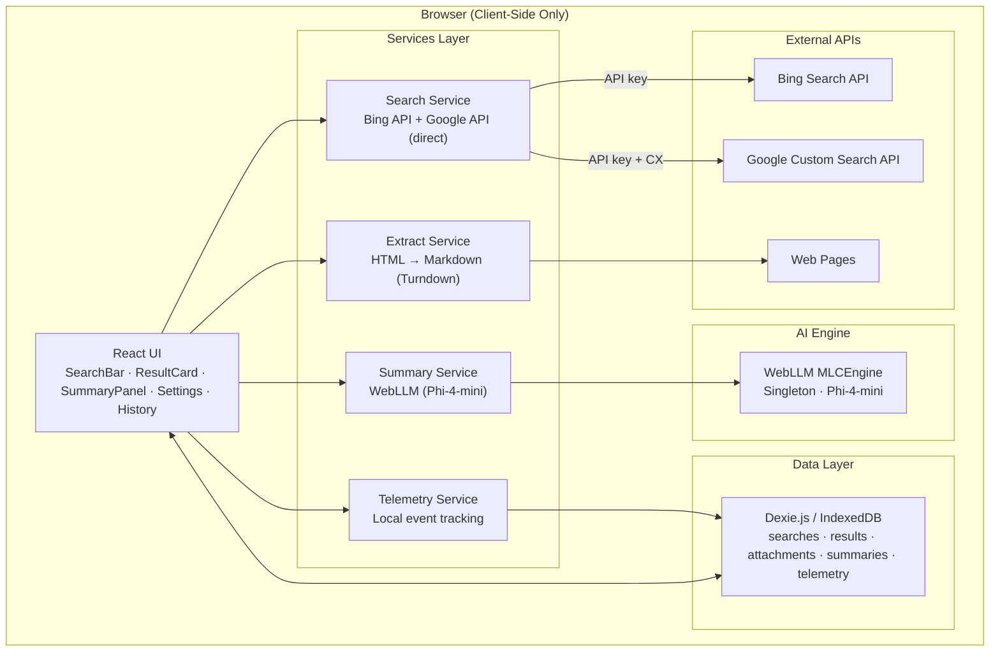
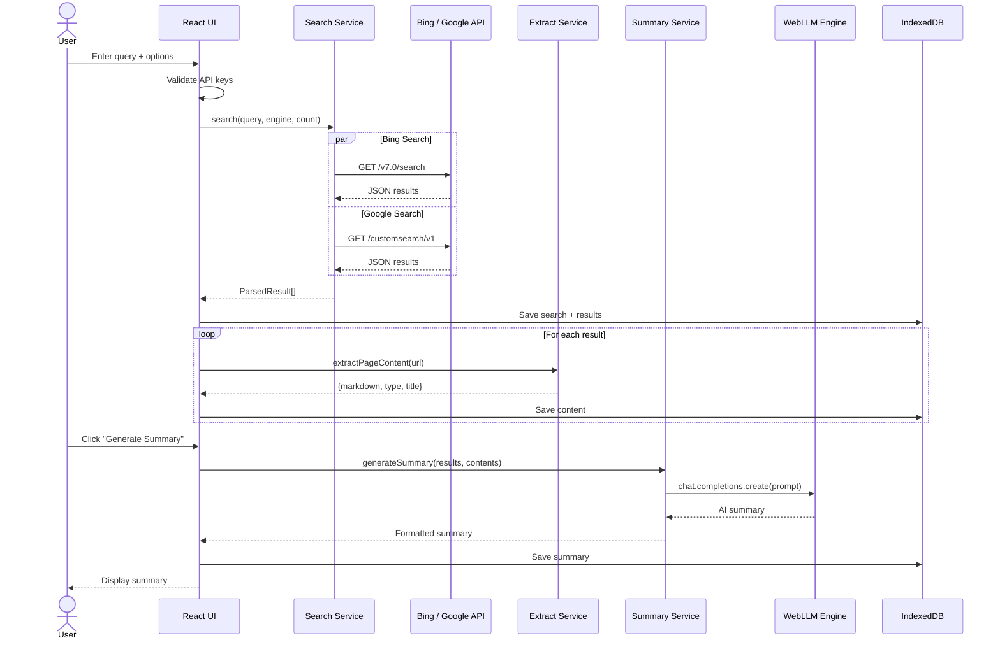
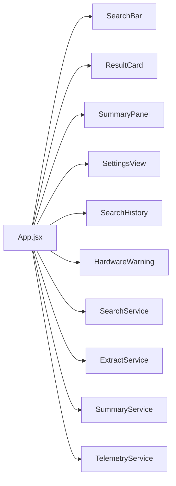
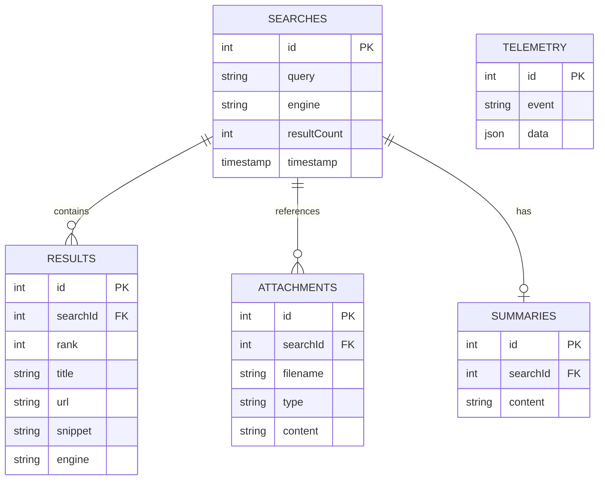

# AttachSurfer

> Privacy-first web search with attachment extraction and AI-powered summarization. All AI processing happens in your browser.

## Features

- **Multi-Engine Search**: Search across Bing and Google via official APIs
- **Attachment Detection**: Automatically identifies and extracts content from attachments
- **Content Extraction**: Converts web pages to readable markdown using Turndown
- **AI Summarization**: Generate summaries from search results using WebLLM (runs entirely in-browser)
- **Search History**: Store and review past searches in IndexedDB
- **Dark/Light Mode**: Modern responsive UI with theme toggle
- **Fully Private**: AI processing is local — no data leaves your browser

## Quick Start

```bash
# Install dependencies
npm install

# Start development server (port 5289)
npm run dev
```

Open [http://localhost:5289](http://localhost:5289) in Chrome or Edge (WebGPU required).

```bash
# Kill process on port 5289 and restart
npm run restart
```

## Configuration

Copy `.env.example` to `.env` and add your API keys:

### Required: Search API Keys

At least one engine key is needed.

| Engine | Key | Where to get it |
|--------|-----|-----------------|
| **Bing** | `VITE_BING_API_KEY` | [portal.azure.com](https://portal.azure.com) → Create "Bing Search v7" resource (free: 1000 calls/month) |
| **Google** | `VITE_GOOGLE_API_KEY` + `VITE_GOOGLE_CX` | [console.cloud.google.com](https://console.cloud.google.com/apis/credentials) for API key, [programmablesearchengine.google.com](https://programmablesearchengine.google.com) for CX |

### Optional Settings

| Variable | Default | Description |
|----------|---------|-------------|
| `VITE_DEFAULT_SEARCH_ENGINE` | `bing` | Default engine: `bing`, `google`, or `all` |
| `VITE_DEFAULT_RESULT_COUNT` | `3` | Default number of results (1-10) |
| `VITE_WEBLLM_MODEL` | `Phi-4-mini-instruct-q4f16_1-MLC` | WebLLM model for summarization |
| `VITE_TELEMETRY_ENABLED` | `true` | Track usage events locally |
| `VITE_STORE_HISTORY` | `true` | Store search history in IndexedDB |

## Usage

1. **Search**: Enter your query and click Search or press Enter
2. **Configure**: Choose search engine, attachment filter, and result count
3. **Explore**: Click "View Extracted Content" on any result to see extracted markdown
4. **Summarize**: Click "Generate Summary" to create an AI-powered summary of all results
5. **Review**: Check the History tab to review past searches
6. **Settings**: Configure default behavior, AI model, and view API key status

## Architecture

### System Overview



### Data Flow



### Component Architecture



### IndexedDB Schema



See [docs/architecture.md](docs/architecture.md) for full details.

## Browser Requirements

- Chrome 113+ or Edge 113+ (WebGPU support)
- 8GB+ RAM recommended
- Internet connection for search and content extraction

## License

MIT
