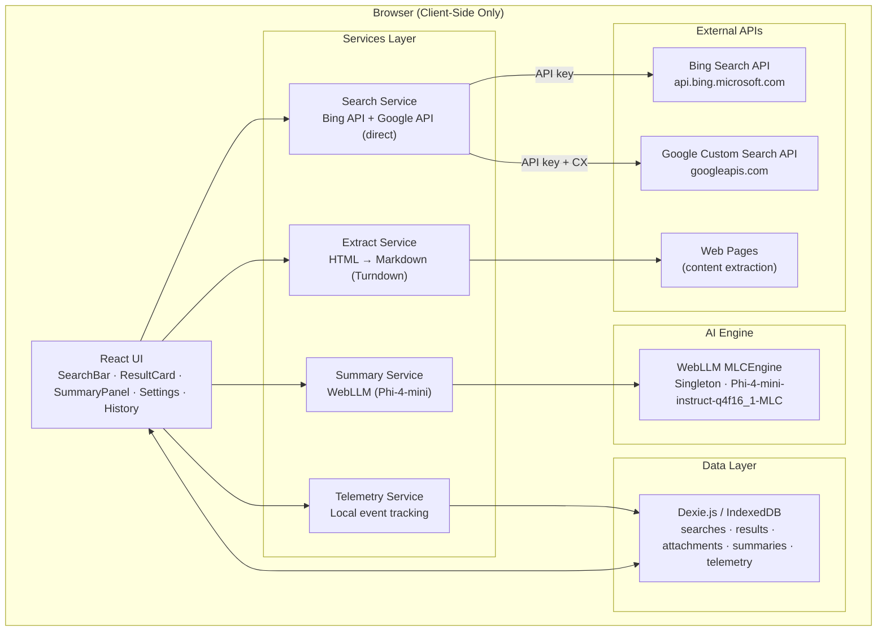
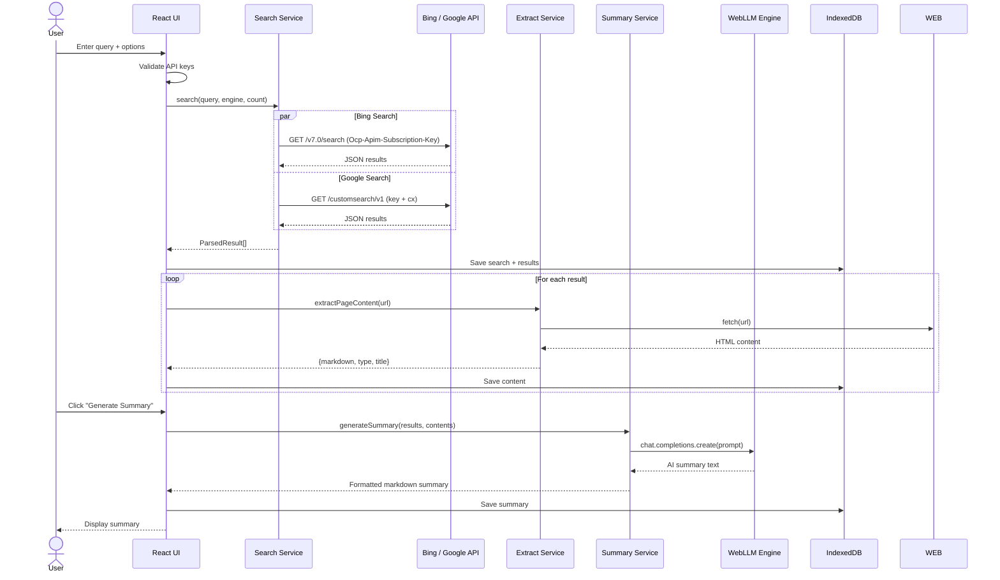
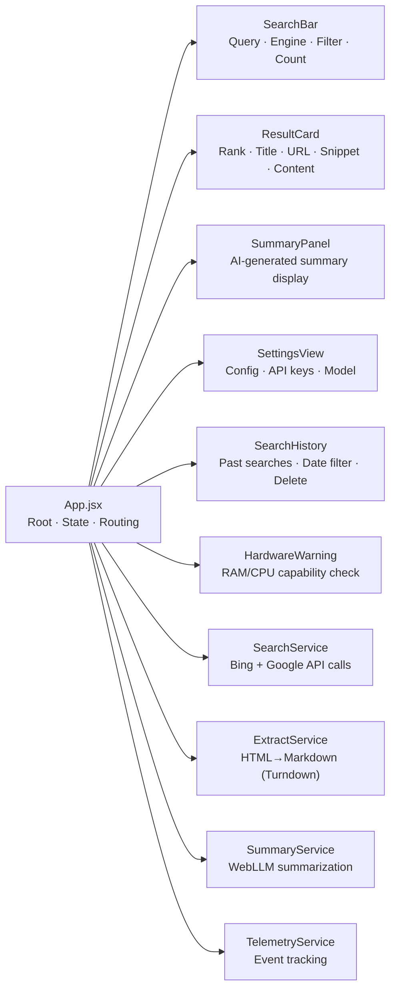
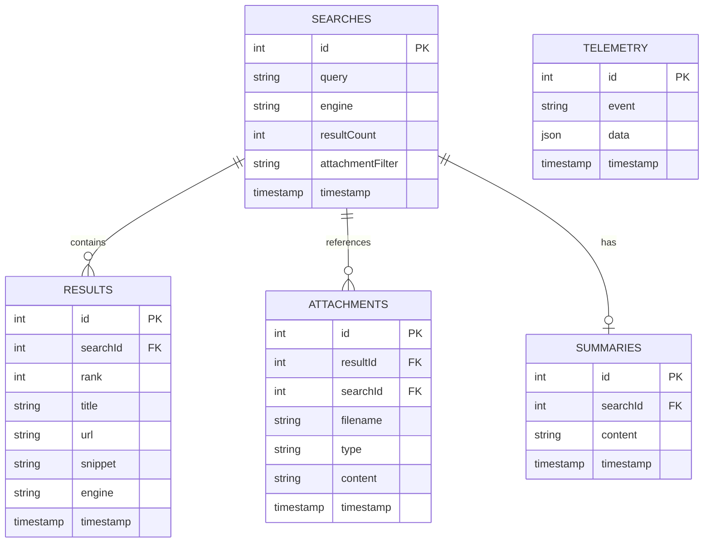

# AttachSurfer Architecture

## Tech Stack

| Layer | Technology | Purpose |
|-------|-----------|---------|
| **UI Framework** | React 19 + Vite 8 | Component-based UI with fast HMR |
| **Styling** | CSS Custom Properties | Dark/light theming, responsive design |
| **Icons** | Lucide React | Consistent icon set |
| **Search APIs** | Bing Search API / Google Custom Search API | Official search API calls |
| **AI Inference** | WebLLM (Phi-4-mini) | Browser-based LLM for summarization |
| **Local Storage** | Dexie.js (IndexedDB) | Search history, results, telemetry |
| **HTML→Markdown** | Turndown | Convert extracted HTML to markdown |
| **Language** | JavaScript (JSX) | No TypeScript overhead |

## System Architecture

## Data Flow

## Component Architecture

## IndexedDB Schema

## Privacy Model

All processing is client-side only:

| Operation | Location | Data Sent Externally |
|-----------|----------|---------------------|
| Search queries | Browser → Bing/Google API | Query text via official API |
| Content extraction | Browser → Target URL | URL only |
| AI summarization | Browser (WebLLM) | Nothing |
| Data storage | Browser (IndexedDB) | Nothing |
| Telemetry | Browser (IndexedDB) | Nothing |

No server, no analytics services, no third-party proxies.
