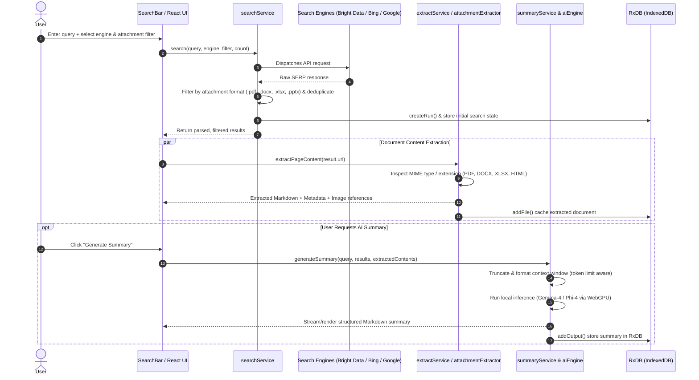
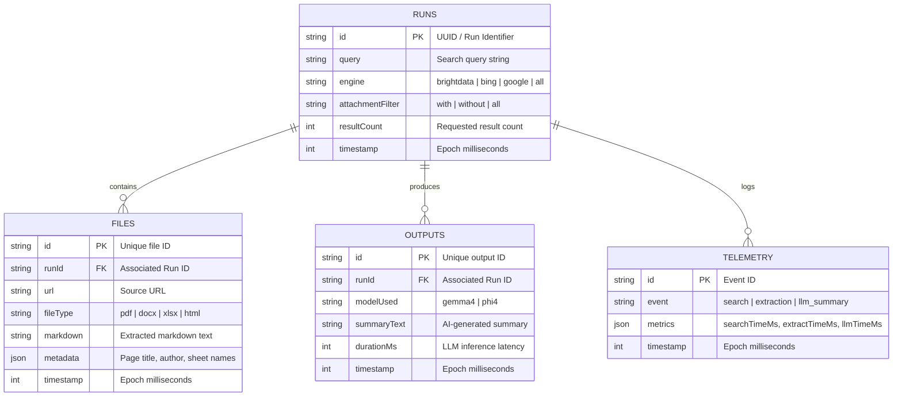

# AttachSurfer Architecture

AttachSurfer is a **privacy-first, client-side web search engine with multi-format attachment extraction and in-browser AI summarization**. All data storage, vector embeddings, content extraction, and LLM inference execute directly inside the user's browser via WebGPU, WebAssembly, and IndexedDB.

---

## 1. Technology Stack

| Layer | Technology | Version | Purpose |
|-------|------------|---------|---------|
| **UI Framework** | React + Vite | 19.2 / 8.0 | Component hierarchy, fast HMR, optimized bundle |
| **Styling** | Vanilla CSS + CSS Variables | Modern CSS | Dark/Light themes, glassmorphism, responsive grid |
| **Local Database** | RxDB | 16.21 | Reactive offline storage for searches, results, attachments, and telemetry |
| **Icons** | Lucide React | 1.14 | Modern, accessible SVG icon library |
| **Search APIs** | Bright Data, Bing, Google | Official APIs | Multi-engine search with attachment targeting |
| **HTML → Markdown** | Turndown | 7.2 | Strips boilerplate and extracts clean Markdown |
| **Document Parsers** | PDF.js, Mammoth, XLSX | 6.4 / 1.13 / 0.18 | Extracts text & tables from PDF, Word (.docx), Excel (.xlsx) |
| **AI LLM Inference** | Gemma 4 & Phi-4 | LiteRT-LM / WebLLM | In-browser causal language modeling for summarization |
| **Embeddings & Search** | EmbeddingGemma-2 | Transformers.js / ONNX | 768-dimensional in-browser vector search & semantic ranking |

---

## 2. System Architecture

```mermaid
graph TB
    subgraph Browser ["Browser Client Environment (100% Client-Side)"]
        subgraph UI ["Presentation Layer (React 19)"]
            SB["SearchBar<br/>(Query, Engine, Filter, Count)"]
            RC["ResultCard & MarkdownViewer<br/>(Preview, Formatted/Raw tabs)"]
            SP["SummaryPanel<br/>(Collapsible AI Summary)"]
            SW["SearchWithinResults<br/>(Semantic & Vector Search)"]
            AD["AnalyticsDashboard<br/>(Latency & Telemetry Metrics)"]
            SH["SearchHistory<br/>(RxDB Run History)"]
            SV["SettingsView<br/>(Engines, Models, Offline Storage)"]
        end

        subgraph Services ["Core Services Layer"]
            SS["searchService<br/>Multi-engine query & deduplication"]
            ES["extractService & attachmentExtractor<br/>PDF, Word, Excel, HTML pipeline"]
            SMS["summaryService<br/>Context window chunking & LLM prompt"]
            EMB["embeddingService<br/>EmbeddingGemma-2 768-dim Vectors"]
            TL["telemetryService<br/>Latency & operational metrics"]
        end

        subgraph AI ["In-Browser AI Execution Engines"]
            direction LR
            G4["Gemma 4<br/>(LiteRT-LM / Transformers.js ONNX)"]
            P4["Phi-4-mini<br/>(WebLLM / WebGPU MLC)"]
            EG2["EmbeddingGemma-2<br/>(Transformers.js / WebGPU)"]
        end

        subgraph Storage ["Persistent Client Storage"]
            RX["RxDB (IndexedDB)<br/>Runs · Files · Outputs · Telemetry · Embeddings"]
        end
    end

    subgraph External ["External Search Providers & Web Pages"]
        BD["Bright Data SERP API"]
        BING["Bing Web Search API v7"]
        GOOGLE["Google Custom Search API"]
        PAGES["Target Web Pages & Attachment URLs"]
    end

    SB --> SS
    SS -->|SERP Query| BD
    SS -->|API Key| BING
    SS -->|Key + CX| GOOGLE
    SS --> RX

    RC --> ES
    ES -->|Fetch CORS/Proxy| PAGES
    ES --> RX

    SP --> SMS
    SMS --> G4
    SMS --> P4
    SMS --> RX

    SW --> EMB
    EMB --> EG2
    EMB --> RX

    AD --> TL
    TL --> RX
```



---

## 3. End-to-End Query & Extraction Flow



---

## 4. RxDB Database Schema

RxDB stores all run sessions and documents locally inside the browser's IndexedDB:



---

## 5. Attachment Extraction Engine

The application includes dedicated parsers for each attachment format:

1. **PDF Documents (`pdfjs-dist`)**:
   - Parses document pages via PDF.js worker.
   - Extracts formatted text blocks and structural headers.
   - Preserves page numbers and metadata (author, creation date).

2. **Word Documents (`mammoth`)**:
   - Parses OpenXML `.docx` files directly into clean HTML.
   - Converts headings, lists, tables, and inline emphasis.
   - Transforms into standardized Markdown.

3. **Excel Spreadsheets (`xlsx`)**:
   - Parses multi-sheet workbooks.
   - Converts sheets into clean Markdown tables for easy reading and AI ingestion.

4. **Web HTML (`turndown`)**:
   - Strips ads, navigation bars, cookie banners, and boilerplate.
   - Preserves document hierarchy, code blocks, lists, and images.

---

## 6. In-Browser AI Models & Offline Architecture

```
public/models/
├── gemma4/                 # Gemma 4 (LiteRT-LM & Transformers.js ONNX)
│   ├── config.json
│   ├── tokenizer.json
│   └── gemma-4-E2B-it-web.litertlm
├── phi4/                   # Phi-4 Mini (WebLLM MLC / WebGPU)
│   ├── mlc-chat-config.json
│   ├── tokenizer.json
│   └── ndarray-cache.json
└── embeddinggemma2/        # EmbeddingGemma-2 (Transformers.js ONNX)
    ├── config.json
    ├── tokenizer.json
    └── onnx/model_quantized.onnx
```

- **Local First**: If models exist in `public/models`, they are served with optimal caching headers directly to the browser.
- **Graceful Fallbacks**:
  - If local weights are unavailable, the application can load from verified remote CDNs/Hugging Face or use deterministic high-dimensional embeddings.
  - Hardware checks automatically monitor WebGPU capability, RAM, and cores to protect low-spec machines.

---

## 7. Privacy & Security Model

- **Zero Server Architecture**: There is no backend application server. The Vite build compiles to static assets.
- **Direct API Authentication**: Search API keys are stored solely in the user's browser `localStorage` or `.env` and sent exclusively to the configured search provider.
- **Local AI Inference**: Model weights are downloaded and executed on the client GPU/CPU. Prompts, documents, and generated summaries never leave the user's device.
